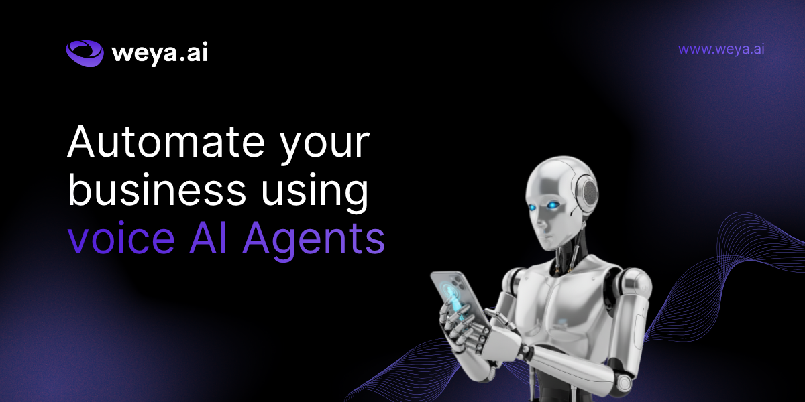

weya is a platform for building conversational AI agents and running them at enterprise scale. You build an agent once, connect it to a channel (a phone number, a WhatsApp Business number or a video link), launch a campaign of contacts, and receive a structured result for every conversation in your CRM or on your own webhook.

These docs cover both ways of working with weya: the **dashboard**, for building and testing agents, and the **REST API**, for running campaigns from your own systems.

## Start here

<Columns cols={2}>
  <Card title="Quickstart: dashboard" icon="rocket" href="/essentials/settings">
    Build an agent, connect a channel and launch your first campaign from the dashboard.
  </Card>

  <Card title="Quickstart: API" icon="terminal" href="/get-started/api-quickstart">
    Create a campaign, add contacts and receive call results with four API requests.
  </Card>

  <Card title="Core concepts" icon="shapes" href="/get-started/concepts">
    Agents, channels, campaigns, contacts and attempts, and how a call moves between them.
  </Card>

  <Card title="Authentication" icon="key" href="/get-started/authentication">
    Create an API key and send it with every request.
  </Card>
</Columns>

## How weya works

Every weya deployment follows the same five steps, whichever channel you use. Step through them below, then open the guide for the step you are on.

<PlatformTour />

<Visibility for="agents">
  1. Build an agent: first message, system prompt, voice, language and call behaviour.
  2. Give it knowledge and tools: knowledge bases, custom API tools, call transfer, post-call WhatsApp.
  3. Connect a channel: a phone number with the agent assigned, a WhatsApp Business number, or a video campaign join link.
  4. Launch a campaign: contacts plus calling numbers, days, hours, timezone and retry rules.
  5. Get the results: post-call metrics sent to your webhook or CRM, and campaign analytics.
</Visibility>

## Build by channel

<Columns cols={3}>
  <Card title="Voice agents" icon="phone" href="/single-prompt/overview">
    Inbound and outbound phone calls, including high-volume voice blasters.
  </Card>

  <Card title="Video agents" icon="video" href="/video-agents/create-video-agent">
    Face-to-face conversations with an AI avatar that people join through a link.
  </Card>

  <Card title="WhatsApp agents" icon="whatsapp" href="/Whatsapp/create-whatsapp-agent">
    Conversations and template messages on your WhatsApp Business number.
  </Card>
</Columns>

## Run and integrate

<Columns cols={2}>
  <Card title="Campaigns" icon="megaphone" href="/campaigns/createcampaign">
    Upload contacts, set calling hours and retry rules, and launch.
  </Card>

  <Card title="Call result webhooks" icon="webhook" href="/integration/webhooks">
    Receive a JSON result for every finished call, with transcript analysis and recording.
  </Card>

  <Card title="Custom tools" icon="plug" href="/tools/customtool">
    Let an agent call your APIs during a conversation.
  </Card>

  <Card title="API reference" icon="code" href="/api-reference/Agents/getAgents">
    Every endpoint for agents, campaigns, phone numbers, knowledge bases, WhatsApp and webhooks.
  </Card>
</Columns>

<Tip>
  Going to production? Work through the [go-live checklist](/get-started/go-live) before your first large campaign.
</Tip>

export const PlatformTour = () => {
  const steps = [
    { label: "Build an agent", detail: "Write the agent's first message and system prompt, choose a voice and language, and set call behaviour. Voice, video and WhatsApp agents are built from the Agents area of the dashboard.", link: "Voice agents, Video agents, WhatsApp agents" },
    { label: "Give it knowledge and tools", detail: "Attach knowledge bases so the agent answers from your documents, and add tools so it can act during a conversation: call your API, transfer the call to a person, or send a WhatsApp message when the call ends.", link: "Knowledge bases, Custom tools" },
    { label: "Connect a channel", detail: "Add a phone number from your telephony provider and assign the agent to it, connect a WhatsApp Business number, or use the join link weya creates for a video campaign.", link: "Phone numbers, Connect a WhatsApp number" },
    { label: "Launch a campaign", detail: "A campaign holds your contacts and the rules for reaching them: calling numbers, days, calling hours, timezone and how many times to retry. Upload a CSV in the dashboard or add contacts through the API.", link: "Create a campaign, API quickstart" },
    { label: "Get the results", detail: "After each call weya analyses the conversation into the post-call metrics you defined, then sends the result to your webhook or CRM. Campaign analytics show progress while it runs.", link: "Call result webhooks, Campaign analytics" },
  ];
  const [active, setActive] = useState(0);
  const nav = { padding: "6px 14px", borderRadius: 8, border: "1px solid rgba(127,127,127,.35)", background: "transparent", color: "inherit", font: "inherit", cursor: "pointer" };
  return (
    

      

        {steps.map((s, i) => (
          <button
            key={i}
            type="button"
            onClick={() => setActive(i)}
            aria-pressed={i === active}
            style={{
              textAlign: "left", padding: 10, borderRadius: 8, font: "inherit", color: "inherit", cursor: "pointer", minWidth: 0,
              border: i === active ? "2px solid #4F1AD6" : "1px solid rgba(127,127,127,.3)",
              background: i === active ? "rgba(79,26,214,.12)" : "transparent",
              opacity: i > active ? 0.6 : 1,
            }}
          >
            
Step {i + 1}

            
{s.label}

          </button>
        ))}
      

      
{steps[active].detail}

      
Guides: {steps[active].link}

      

        <button type="button" style={nav} disabled={active === 0} onClick={() => setActive(active - 1)}>Back</button>
        <button type="button" style={nav} disabled={active === steps.length - 1} onClick={() => setActive(active + 1)}>Next</button>
      

    

  );
};
